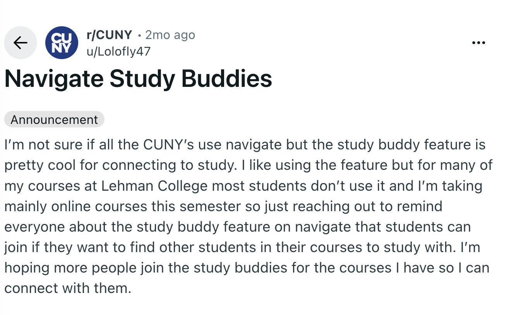
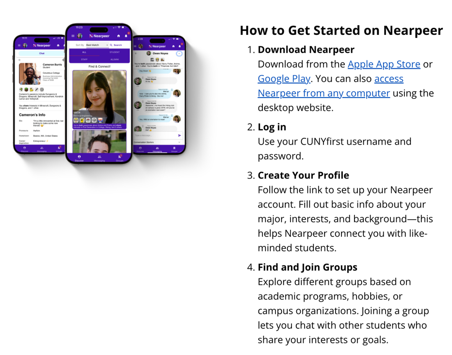
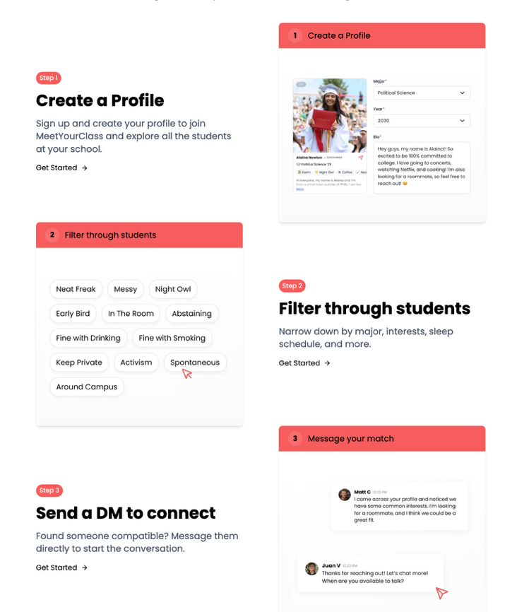
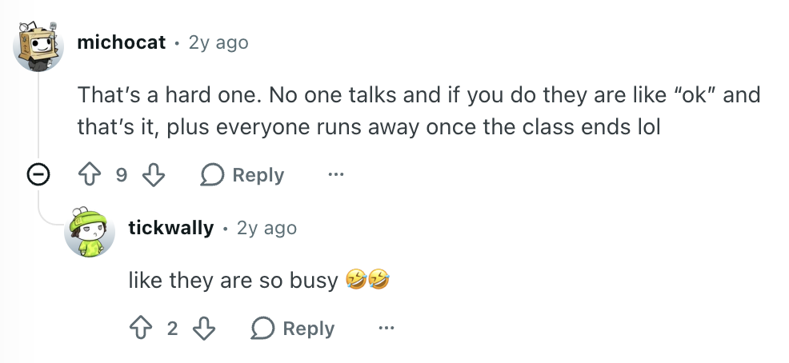
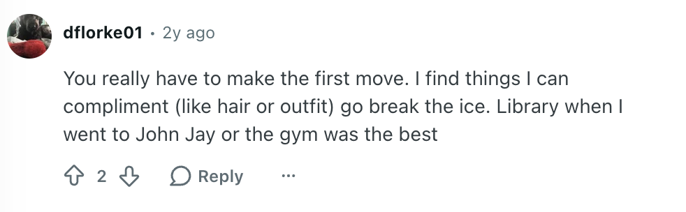
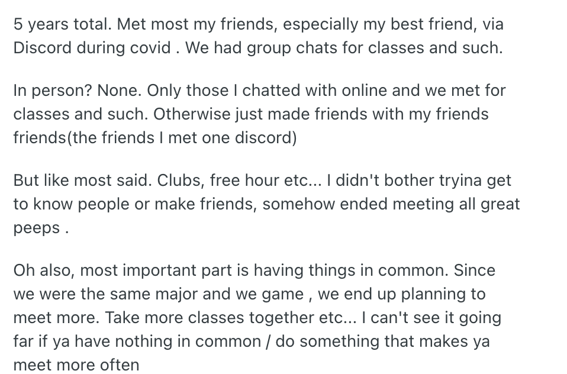

# User & Market Research – CUNY Buddies

Author: Daniil Nasadiuk (Product / UX)

**CUNY Buddies** lets CUNY students upload a photo or PDF of their course schedule. The app detects their class blocks and free time, then recommends people who share their classes and free windows.

---

## 1. Competitors

### Navigate Study Buddies (EAB)
Used at several CUNY colleges to match students by course section, but matching happens over email. On r/CUNY, a Lehman College student said "most students don't use it."

### Nearpeer (BMCC)
Matches by interests, major and background, but doesn't look at schedules. It's aimed at incoming students, not current ones.

### MeetYourClass (Brooklyn College and others)
A national roommate and Instagram-intro platform for admitted students. The official Brooklyn College page has about 60 members. Because it's built around roommates, it's a poor fit for commuters.

### Feature comparison

| Feature | Navigate Study Buddies | Nearpeer | MeetYourClass | Discord / clubs | CUNY Buddies (planned) |
|---|---|---|---|---|---|
| CUNY login or verified student | Yes (Navigate) | Yes (CUNYfirst) | Manual proof | No | Yes (CUNY email) |
| Matches by same class | Yes, by section | Groups by major | No | Class servers | Yes |
| Matches by interests | No | Yes | Roommate filters | Club topic | Yes |
| Matches by free time between classes | No | No | No | No | **Yes** |
| In-app chat | No, email only | Yes | Yes | Yes | Planned, Sprint 2 |
| Suggests what to do together | No | No | No | No | Yes ("study at the library") |
| Built for current students, not just incoming | Yes | Mostly incoming | Incoming | Yes | Yes |
| Works across CUNY campuses | Per college | Per college | Per college | Varies | One app, campus-aware |

**Our gap:** none of these matches students by *free time between classes*, which is the core of CUNY Buddies.

---

## 2. User research

**Method:** searched r/CUNY for threads on how students make friends and why they don't connect ("How do I make friends in college?", "Why don't students connect").

**Assumptions to test:**
- Many students are introverted and wait for someone else to go first.
- Many students are commuters who leave campus right after class, so they may not be introverts at all.

### Key findings

1. **Commuting kills the moment after class.** The free block right after class is the moment our app needs to catch.

   

2. **Nobody wants to go first.** Make the first message easy (a suggested opener) and free, and limit later interactions.

   

3. **Shared interests plus a reason to meet again.** Combine classes, interests and recurring free time, since the same weekly gap repeats.

   

4. **Online first, then in person.** Suggested activities should be real places and plans on campus.

### What to add
1. In-app chat
2. Icebreaker on first contact
3. Group or club spaces, not only one-on-one

### Risks
1. **Empty room:** the app is useless until enough students at a campus join.
2. **Competing with official tools:** Navigate and Nearpeer are already provided by colleges.
3. **Schedule privacy:** students may not want to share their schedule with strangers.

---

## 3. Next steps

- Install Navigate Student and Nearpeer and screenshot their onboarding and matching flows.
- Ask friends at Brooklyn College and BMCC whether they've heard of MeetYourClass or Nearpeer.
- Run a 2-minute poll in class Discords and group chats:
  1. Walk me through a normal day on campus. What do you do between classes?
  2. Have you made a friend at CUNY? How did it start?
  3. Have you used Navigate Study Buddies, Nearpeer or a class Discord? What happened?
  4. What would make you message a classmate you don't know?
  5. Would you share your class schedule with other CUNY students? With whom?
  6. If the app said "3 classmates are free with you right now," what would you do?

See [design/README.md](design/README.md) for the user schema and mockups.
